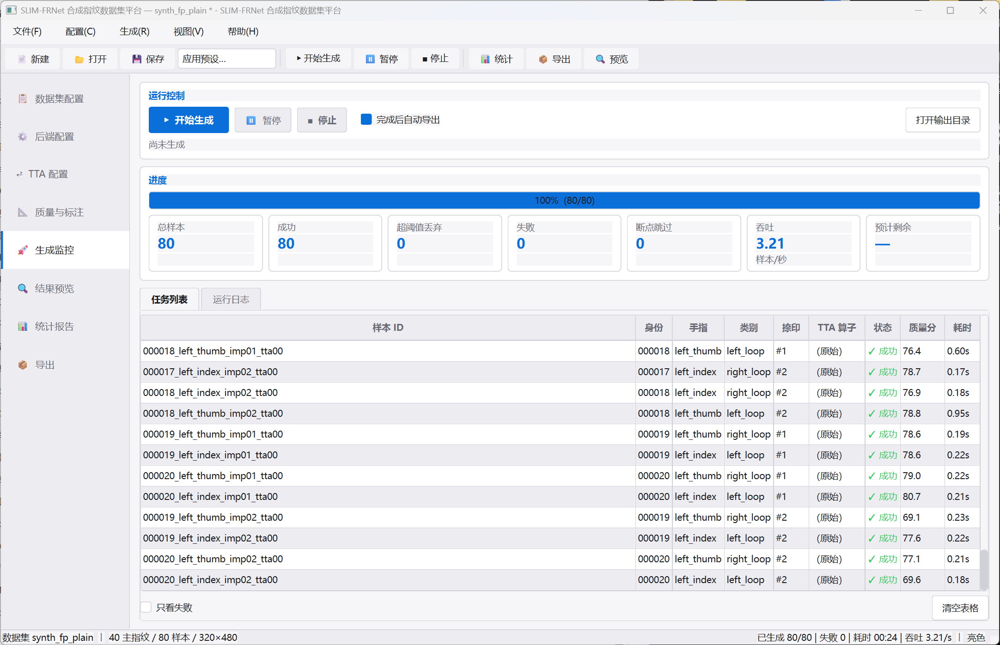
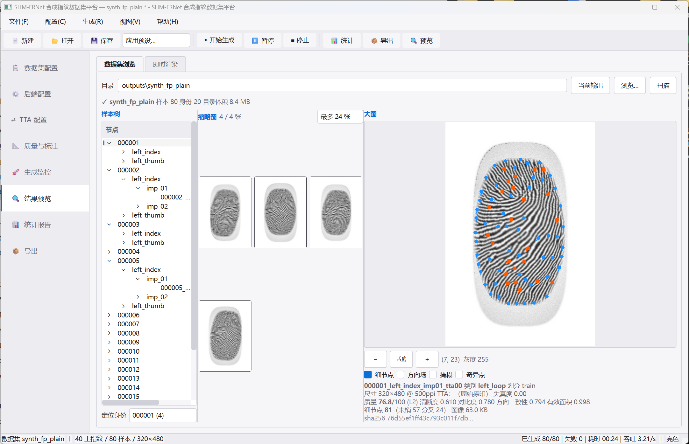
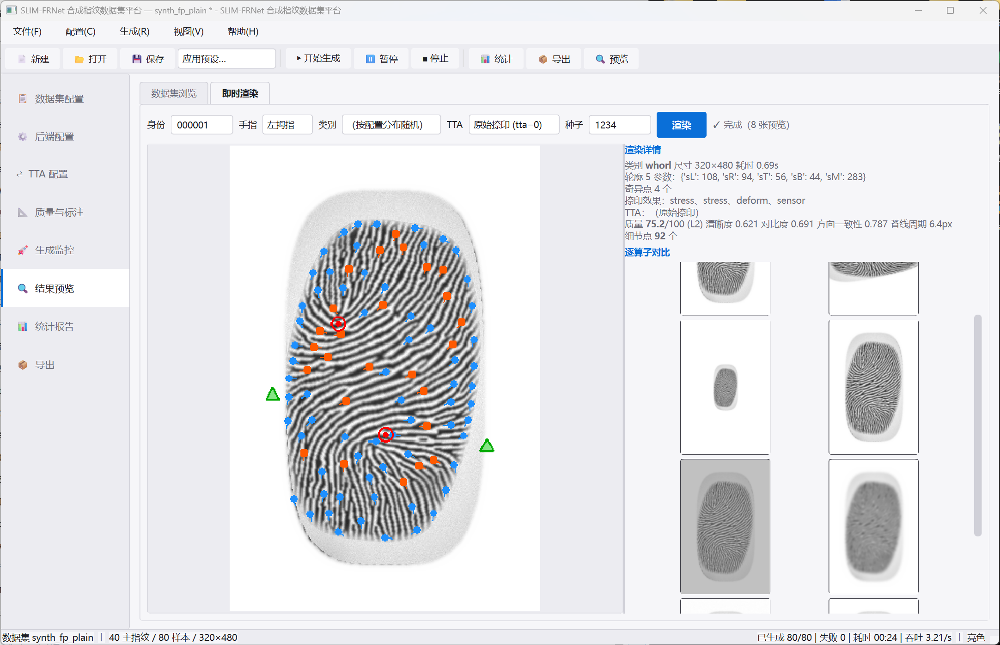
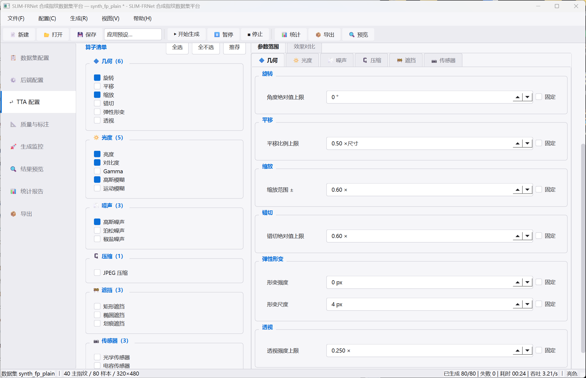
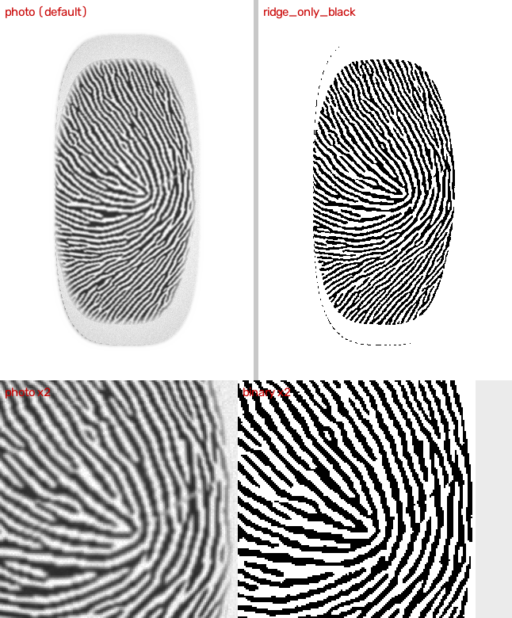

# SLIM-FRNet · 合成指纹数据集平台

[](https://github.com/xf785/slim-frnet/actions/workflows/ci.yml)
[](LICENSE)
[](https://www.python.org/)
[](tests/)

> 版本 **v2.0** ｜ GUI 优先 ｜ 4 个核心依赖 ｜ 完全可复现 ｜ MIT
> 按 [设计文档](docs/DESIGN.md) 对原项目做架构级重建：保留已验证的生成内核，重写配置、核心域层、插件层、服务层与图形界面。

一键生成**完全可复现**的合成指纹数据集：主指纹 → 捺印（形变 / 传感器 / 退化链）→ TTA，
输出图像、掩模、方向场、细节点、质量分、划分与校验和，附 8 页图形界面。

<!-- 界面截图 -->
| 生成监控 | 结果预览 |
|---|---|
|  |  |
| **即时渲染（逐算子对比）** | **TTA 配置** |
|  |  |

---

## ⚠️ 合成数据声明

本软件生成的图像**完全由算法合成**，不含任何真实人类指纹数据，不涉及个人生物特征信息。
生成算法复刻自 SFinGe 方法学（Cappelli et al., *Synthetic Fingerprint-Image Generation*, ICPR 2000）。
可用于算法研究、模型预训练、数据增强与教学；**不得**用于冒充真实身份或规避生物识别系统。

---

## 1. 30 秒上手

**Windows 用户最省事**：双击 [start_gui.bat](start_gui.bat) 即可（自动找 Python、检查依赖、启动界面）。
命令行同理，双击 [start_cli.bat](start_cli.bat)，或 `start_cli.bat selfcheck`。

手动方式：

```bash
# 1) 安装（核心只有 4 个依赖 + 一个 Qt 绑定）
pip install -r requirements.txt

# 2) 自检：不需要任何外部数据，验证整条链路
python -m synthfp selfcheck

# 3) 生成一个小数据集（约 30 秒）
python -m synthfp generate --preset quick_test

# 4) 启动图形界面（推荐入口）
python -m synthfp gui
```

> GUI 需要 PySide6 **或** PyQt6，装一个就够。程序优先用 PySide6，
> 找不到时自动回退 PyQt6 —— 已经装了 PyQt6 的机器不必再装 PySide6。

生成结果：

```
outputs/quick_test/
├── README.md                  # 数据集说明（合成声明 + 字段释义 + 复现方法）
├── dataset_manifest.jsonl     # 每行一个样本的完整记录（唯一元数据来源）
├── plan.jsonl                 # 生成计划（可复现依据）
├── config.resolved.yaml       # 实际生效的完整配置
├── environment.json           # 环境快照
├── stats.json                 # 统计报告
├── splits/train.csv           # 按身份划分（无身份泄漏）
├── checksums/sha256sums.txt   # 全量文件校验和
├── images/000001/left_thumb/imp_01/000001_left_thumb_imp01_tta00.png
├── mask/ orientation/ frequency/ centerline/ quality/ minutiae/
└── logs/{generation,done,failed}.jsonl
```

---

## 2. 它做什么

一条完整的样本管道（设计文档 4.4）：

```
主指纹（每个手指只算一次）
  手指轮廓 5 参数模型 → Core/Delta 奇异点 → Zero-Pole 方向场
  → 多层 Perlin 频率图 → Gabor 迭代脊线合成
        │
        ├── 捺印 #1 ── 随机退化链 → 皮肤按压变形 → 传感器特性 ──┬── TTA #0（原始对照）
        │                                                      ├── TTA #1
        │                                                      └── TTA #2 …
        ├── 捺印 #2 ── …（同上）
        └── 捺印 #N
                │
                └── 每个样本：TTA → 质量评估 → 细节点提取 → 标准化存储 → Manifest
```

**为什么以「主指纹」为任务粒度**：主指纹合成是整条链里最贵的一步（Gabor 迭代）。
把它放在条目内复用，使「每个手指只算一次」成为**结构性保证**而不是缓存碰运气，
增加捺印数与 TTA 数的边际成本因此变得很低。

---

## 3. 图形界面（一级入口）

双击 [start_gui.bat](start_gui.bat)，或 `python -m synthfp gui`。
打开后是三区布局：左侧导航 ｜ 中央页面 ｜ 底部状态栏。

想先在没显示器的环境里看界面长什么样（CI、远程 shell），可以离屏截图：

```bash
python tools/shoot_gui.py --dataset outputs/demo
# → outputs/gui-shots/01_数据集配置.png … 08_导出.png
```

| 页面 | 内容 |
|------|------|
| **1. 数据集配置** | 身份数 / 手指数 / 捺印数 / TTA 数、输出目录、类别比例（实时归一化 + 预计样本数）、划分比例 |
| **2. 后端配置** | 后端选择、分辨率预设或自定义尺寸、脊线合成全部参数、外观、手指轮廓比例、奇异点；一键「渲染测试图」看耗时 |
| **3. TTA 配置** | 21 个算子分 6 类勾选、逐个参数滑块 + 「固定」开关、组合策略；**效果对比**页实时渲染逐算子结果 |
| **4. 质量与标注** | 质量阈值与丢弃策略、细节点提取参数、ISO 模板、标注产物开关、捺印阶段（变形 / 传感器 / 退化链） |
| **5. 生成监控** | 进度条、7 个实时统计卡片、任务表（含状态与质量分）、彩色日志、暂停 / 恢复 / 停止、失败筛选 |
| **6. 结果预览** | 数据集树浏览 → 缩略图网格 → 大图（缩放 / 平移），可叠加掩模、细节点、方向场、奇异点；另有「即时渲染」页实时调参 |
| **7. 统计报告** | 类别 / 质量 / 细节点 / TTA 算子 / 划分 / 手指 六个视角的分布表，均可导出 CSV |
| **8. 导出** | 逐项选择导出内容（README / 统计 / 校验和 / 划分 / 环境）、可选打包 ZIP、数据集结构总览、复现命令一键复制 |

界面细节：

- GUI **不直接调用任何生成逻辑**，只调用应用服务层；服务层用回调上报进度，
  由 `synthfp/gui/qt_bridge.py` 转成 Qt 信号（跨线程队列投递），因此主线程永不阻塞。
- 参数改动**即时 Pydantic 校验**：非法值不会落地，控件回滚并给出可读的错误定位。
- 未捕获异常写入 `crash.log` 并弹窗提示，不会静默崩溃（原项目最大的痛点）。
- 暗色 / 亮色主题（菜单「视图 → 主题」），不依赖 qdarktheme 等额外包。

---

## 4. 命令行（高级用户）

```bash
python -m synthfp --help

# 生成
python -m synthfp generate --preset quick_test
python -m synthfp generate -c configs/default.yaml --set runtime.workers=8
python -m synthfp generate --preset large_research --set dataset.identities=50 --dry-run

# 计划预览（不写任何文件）
python -m synthfp plan --preset default --json

# 数据集操作
python -m synthfp stats    --dataset outputs/synth_fp_v1
python -m synthfp validate --dataset outputs/synth_fp_v1 --check-hash   # 重算 SHA-256
python -m synthfp export   --dataset outputs/synth_fp_v1                 # 幂等重导出

# 配置
python -m synthfp presets                                        # 列出 10 个内置预设
python -m synthfp show --preset high_quality_only                # 摘要
python -m synthfp show --preset default --resolved               # 完整 YAML

# 单张预览（不落盘，可 --save）
python -m synthfp preview --preset default --finger left_thumb --tta 1 --save out.png

# 自检
python -m synthfp selfcheck

# 图形界面
python -m synthfp gui
```

`--set` 使用点号路径，可重复，值按 YAML 解析：

```bash
python -m synthfp generate \
  --set dataset.identities=200 \
  --set dataset.tta_per_impression=5 \
  --set tta.mode=chain --set 'tta.chain_length=[2,3]' \
  --set 'tta.operators=[rotate,elastic,blur,jpeg]' \
  --set quality.min_score=55 --set quality.reject_on_fail=true \
  --set runtime.workers=12
```

---

## 5. 内置预设

| 预设 | 规模 | 用途 |
|------|------|------|
| `default` | 10×2×2×3 = 120 | 标准数据集 |
| `quick_test` | 2×1×1×2 = 4 | 环境自检 |
| `large_research` | 500×4×3×4 = 24000 | 科研大规模集 |
| `high_quality_only` | 120（阈值 60 分丢弃） | 清晰度敏感任务 |
| `robust_low_quality` | 120（重度退化 + 噪声遮挡链） | 鲁棒性 / 拒识研究 |
| `class_balanced` | 50×2×2×3 = 600 | 五类各 20%，分类任务 |
| `whorl_only` / `arch_only` / `loop_only` | 120 | 单类别研究 |
| `no_tta` | 10×2×2×1 = 40 | 只要干净捺印基底 |

预设是**对默认配置的覆盖片段**而非独立 YAML 副本，因此 schema 升级时预设自动跟随、不会腐化。

---

## 6. 可复现性

四要素缺一不可（设计文档 0.2）：

| 要素 | 落盘位置 |
|------|---------|
| **配置** | `config.resolved.yaml` + manifest 每行的 `config_fingerprint` |
| **种子** | `runtime.seed` 派生整棵种子树，每个样本的种子写在 manifest 的 `seed` 字段 |
| **版本** | `environment.json`（Python / 平台 / numpy / opencv / pydantic / synthfp 版本） |
| **校验和** | `checksums/sha256sums.txt` + manifest 每行的 `sha256` |

种子派生是**纯 SHA-256 层级树**（`synthfp/core/seeds.py`），不使用 Python 的 `hash()`：

```
dataset → identity → finger → impression → tta
```

因此：同一份配置 + 同一个种子，在任何机器、任何进程、任何线程数下都得到**逐像素相同**的结果。
`synthfp selfcheck` 会实测这一点（同种子两次渲染逐像素比对）。

---

## 7. 目录结构

```
synthfp/
├── config/          配置系统：Pydantic schema + YAML 读写 + 10 个预设
├── core/            核心域层
│   ├── seeds.py         确定性种子树（可复现基石）
│   ├── types.py         全部领域数据结构（单一数据源）
│   ├── planner.py       计划展开 + 按身份划分（防泄漏）
│   ├── scheduler.py     任务调度（线程池 / 串行、断点续传、失败隔离）
│   ├── manifest.py      唯一元数据来源（jsonl 追加写）
│   ├── storage.py       目录布局 + 原子写 + 校验和
│   └── quantize.py      方向场/频率图的 uint8 紧凑量化
├── pipeline/        样本管道：chain（可复现算子链选择）/ runner / stages
├── plugins/         插件层
│   ├── backends/        SFinGe 后端（复刻内核）、Dummy 后端
│   ├── impressions/     皮肤按压变形、4 种传感器特性
│   ├── tta/             21 个 TTA 算子（4 类）
│   ├── quality/         自研 NFIQ2 风格质量评分
│   └── minutiae/        向量化 Zhang-Suen + Crossing Number + ISO 模板
├── app/             应用服务层：GenerationService / PreviewService / exporter / stats
├── gui/             图形界面（8 页面 + 主题 + 控件库）
│   ├── qt.py            Qt 绑定兼容层（PySide6 / PyQt6）
│   └── pages/           8 个页面，声明式「配置 ↔ 控件」双向绑定
├── legacy/          **原项目已验证的生成内核**（保留资产，最小改造）
│   ├── render/          轮廓 / 奇异点 / 方向场 / 频率图 / Gabor 脊线
│   ├── degrade/         19 个指纹退化算子（作为捺印扰动复用）
│   └── util/            Unicode 安全图像读写
└── cli.py           CLI（仅用标准库 argparse）

start_gui.bat                 双击启动图形界面（自动找 Python、检查依赖）
start_cli.bat                 双击打开命令行 / 快速执行子命令
configs/default.yaml          默认配置（从 schema 生成）
docs/DESIGN.md                重建设计文档（架构决策与取舍）
docs/CONTRACTS.md             插件层接口契约（并行开发的唯一约定）
docs/screenshots/             界面截图（README 顶部展示用）
docs/images/                  样例图（照片模式 / 二值模式对比、数据集预览表）
tools/gen_default_config.py   重新生成默认配置（`--check` 校验是否漂移）
tools/make_preview_sheet.py   把数据集渲染成对比图（主指纹 × 捺印 × TTA + 标注叠加）
tools/shoot_gui.py            离屏渲染 8 个页面为 PNG（无显示器也能检查界面）
tools/launch_gui.vbs          无黑色控制台窗口启动界面（start_gui.bat 调用同一路径）
tools/cleanup_locked.ps1      管理员清理受限沙箱遗留的不可删除空目录
```

依赖方向是**单向**的：`gui → app → {pipeline, core} → plugins → legacy`。
`core` 与 `pipeline` 完全不依赖 Qt，因此可以在无图形环境（服务器 / CI）里跑通。

---

## 8. 依赖（刻意保持最小）

| 包 | 用途 | 必要性 |
|----|------|--------|
| `numpy` | 数组与数值计算 | 必需 |
| `opencv-python` | 滤波 / 重映射 / 编解码 | 必需 |
| `pydantic` | 配置校验（单一事实来源） | 必需 |
| `PyYAML` | 配置读写 | 必需 |
| `PySide6` **或** `PyQt6` | 图形界面（二者任选其一即可） | 必需（GUI 是一级入口） |
| `pytest` / `ruff` | 测试与静态检查 | 开发 |

**Qt 双绑定支持**：GUI 通过 `synthfp/gui/qt.py` 这一个兼容层访问 Qt，
它优先用 PySide6（设计文档 3.5 的选型），找不到就自动回退到 PyQt6。
两边枚举用法一致，只有信号/槽命名不同（`Signal`/`Slot`/`Property`
对 `pyqtSignal`/`pyqtSlot`/`pyqtProperty`），差异全部收敛在那一个文件里。
因此：

```bash
pip install PySide6     # 推荐
# 或
pip install PyQt6       # 环境里已有 PyQt6 时直接可用，无需再装
```

界面代码里任何地方都不会出现 `from PySide6 ...` 或 `from PyQt6 ...`
（有单元测试守着这条约束）。

**刻意不引入**：scipy、scikit-image、matplotlib、pandas、click、tqdm、
qdarktheme、pyqtgraph —— 需要的功能都用 numpy/opencv 自己实现
（质量评分、向量化骨架化、统计图表、进度显示）。

---

## 9. 性能

在 8 核机器上 320×480 单张主指纹的实测：

| 配置 | 单张耗时 | 说明 |
|------|---------|------|
| 默认（频率档数 5，迭代分辨率 0.7） | **约 0.7 s** | 推荐 |
| 迭代分辨率 1.0（最锐利） | 约 1.3 s | 追求最高脊线锐度时使用 |
| 原项目未优化实现 | 约 4.8 s | 逐像素 Zhang-Suen + 无核缓存 + 20 频率档 |

三个优化点（算法一行未改）：

1. **Gabor 核库模块级缓存** —— 720 个核只构建一次，跨样本/跨实例复用；
2. **频率档数 20 → 5** —— 指纹局部脊线周期变化平缓，5 档足够；档数直接决定每次迭代的卷积次数；
3. **迭代分辨率比例 0.7 + 移除内嵌细化** —— 卷积量约减半；Zhang-Suen 改由细节点插件在
   **最终样本图**上做一次（向量化 LUT 实现，500×500 约 20 ms），而不是每个主指纹做一遍
   O(200×H×W) 的 Python 循环。

任务调度用线程池：重活是 OpenCV 的滤波 / 重映射，这些调用会释放 GIL。
（进程池在 Windows 上需要排队 + pickle 传输 numpy 数组，且模块级核缓存无法跨进程复用，实测更慢。）

---

## 10. 常见问题

**Q：生成的指纹看起来像「圆角方块」？**
A：那是 SFinGe 5 参数模型的固有轮廓（矩形中段 + 上下椭圆帽）。
默认使用 `backend.shape_style = round`（超椭圆指腹轮廓）更自然；
需要与原版逐像素对照时改成 `box`。

**Q：`tta_index = 0` 为什么没有算子？**
A：这是刻意设计 —— 每个捺印的第 0 个样本保留**未变换的原始捺印**作为干净对照，
所有 TTA 从 `tta_index >= 1` 开始。若只想要变换结果，把 `tta_per_impression` 调大即可。

**Q：生成中断了怎么办？**
A：直接重跑同样的命令。调度器读取 `logs/done.jsonl` 并逐样本确认图像仍在磁盘上，
只补生成缺失的样本，日志里会显示「断点续传：跳过 N 个已完成样本」。

**Q：想换自洽模型（Turing 等）怎么办？**
A：实现 `synthfp/plugins/backends/base.py` 的 `FingerprintBackend`
（只需 `generate_master(spec) -> MasterArtifact`），用 `@BackendRegistry.register` 注册，
GUI 的「后端配置」页会自动出现该后端，配置里 `backend.name` 改成它即可。

**Q：生成出来的脊线密度和真实指纹不一样？**
A：真实 500 dpi 指纹的脊线周期（一脊 + 一谷）约 **8~12 px**（0.4~0.6 mm），
脊线约占总宽度一半。本项目按这个物理量标定，并有用例守着
（`tests/test_backend_ridge.py` 用自相关测周期，超出 7~14 px 就失败）。
调密度请改「后端配置 → 脊线合成 → 最窄/最宽脊宽」：
数值是**一个周期占多少像素**，调小变密、调大变得稀疏。

**Q：想只保留黑色脊线（做分割 / 细化的标注或输入）？**
A：勾选「后端配置 → 外观 → 仅脊线显示为黑色（纯二值图）」，
或配置 `backend.ridge_only_black: true`。输出只有 0 与 255 两个取值：
脊线纯黑、谷线纯白，纹理与底噪一并关闭，也不做边缘羽化。



左上：默认（照片）模式；右上：`ridge_only_black`；下一行是局部 2× 放大。
两种模式对同一种子完全确定，因此可用于同一身份的多任务标注。

**Q：质量分是 NFIQ2 吗？**
A：不是商用 NFIQ2，而是自研的 **NFIQ2 风格**评分（五项加权：脊线清晰度 35% / 对比度 20% /
方向一致性 25% / 有效面积 10% / 脊线周期合理性 10%），等级 L1–L5 与 NFIQ2 同向。
好处是零外部依赖、跨平台一致、完全确定；manifest 字段名沿用 `nfiq2` 以便下游统一处理。

---

## 11. 测试

```bash
python -m pytest tests -o addopts="" -q     # 全量（约 25 秒）
python -m pytest tests/test_tta.py -q       # 单个模块
```

当前状态：**912 passed**。覆盖范围：

| 文件 | 用例 | 内容 |
|------|------|------|
| `test_tta.py` | 465 | 21 个 TTA 算子：确定性、值域、不修改输入、参数复现 |
| `test_quality.py` | 68 | 六项质量指标 + 综合评分 + 分级边界 |
| `test_impressions.py` | 77 | 压力位移场、变形、4 种传感器、坐标映射 |
| `test_config.py` | 64 | 预设、校验拒绝、YAML 往返与幂等、点号覆盖（含元组下标）、合并语义 |
| `test_core.py` | 56 | 种子树、计划确定性、划分、Manifest、存储、量化 |
| `test_minutiae.py` | 55 | 向量化 Zhang-Suen、CN 检测、伪点过滤、ISO 模板 |
| `test_pipeline.py` | 37 | 算子链、端到端落盘、可复现性、失败隔离与重试、二值收口 |
| `test_app.py` | 33 | 服务回调、断点续传、导出幂等、统计自洽 |
| `test_cli.py` | 28 | 全部子命令、退出码、错误路径、GBK 控制台输出 |
| `test_gui.py` | 22 | 8 页面构造与刷新、主窗口导航、Qt 兼容层约束、GUI 驱动整链路生成、外观控件回填 |
| `test_backend_ridge.py` | 7 | 脊线周期（自相关 7~14 px）、占空比、灰度对比、二值模式 |

### 受限沙箱下的临时目录

`tests/conftest.py` 会先探测「能否读取一个 0o700 目录」。如果不行
（Windows 上以受限令牌运行的自动化沙箱会这样），它只做两件收尾工作：
把建目录的权限位放宽到 0o777，并把 pytest 的临时根挪到工作区内的
`.pytest-work/`。两者都只作用于**本次测试进程**，不改测试语义；
普通环境下探测通过，完全不做替换。

若 `tests/` 下出现 `_sfp_probe_*`、`_pytmp`、`pytest-cache-files-*` 这类
**连自己都读不了**的空目录（受限沙箱的遗留物），普通删除会报拒绝访问。
用管理员 PowerShell 跑一次 [tools/cleanup_locked.ps1](tools/cleanup_locked.ps1) 即可：

```powershell
powershell -ExecutionPolicy Bypass -File tools\cleanup_locked.ps1
```

脚本只删清单里的名字（逐个校验必须位于工作区内），不碰任何项目文件。
这些目录也已在 `.gitignore` 与 pytest 的 `norecursedirs` 中排除，
所以**即使暂时清不掉，`pytest tests` 也照常工作**。

---

## 12. 参考文献

1. Cappelli, R. et al. "Synthetic Fingerprint-Image Generation." *ICPR*, 2000.
2. Cappelli, R. "SFinGe: an Approach to Synthetic Fingerprint Generation." *BioAuth Workshop*, 2004.
3. Maltoni, D. et al. *Handbook of Fingerprint Recognition.* Springer, 2009.
4. Sherlock, B.G., Monro, D.M. "A Model for Interpreting Fingerprint Topology." *Pattern Recognition*, 1993.
5. Vizcaya, P.R., Gerhardt, L.A. "A Nonlinear Orientation Model for Partial Fingerprints." *Pattern Recognition*, 1996.
6. Perlin, K. "An Image Synthesizer." *SIGGRAPH*, 1985.
7. Zhang, T.Y., Suen, C.Y. "A Fast Parallel Algorithm for Thinning Digital Patterns." *CACM*, 1984.

---

## 13. 参与贡献 / 引用 / 许可

- 想改代码？先看 [CONTRIBUTING.md](CONTRIBUTING.md)（环境、约定、扩展点），
  以及 [docs/CONTRACTS.md](docs/CONTRACTS.md)（插件接口契约）。
- 用它产出了论文/数据集？引用信息见 [CITATION.cff](CITATION.cff)。
- 本项目以 **MIT License** 发布，版权归 **SLIM-FRNet**，
  全文见 [LICENSE](LICENSE)。

### 关于合成数据的使用边界

MIT 许可授予你对**代码**的广泛自由；但请注意：生成的图像是**算法合成的**，
不含任何真实人类指纹。请勿把它们用于冒充真实身份、规避生物识别系统，
或在未声明的场合充当真实采集数据。学术使用时，建议在论文中显式注明数据由本工具合成
（数据集里的 `README.md` 与 `environment.json` 已自动带上该声明与可复现信息）。

